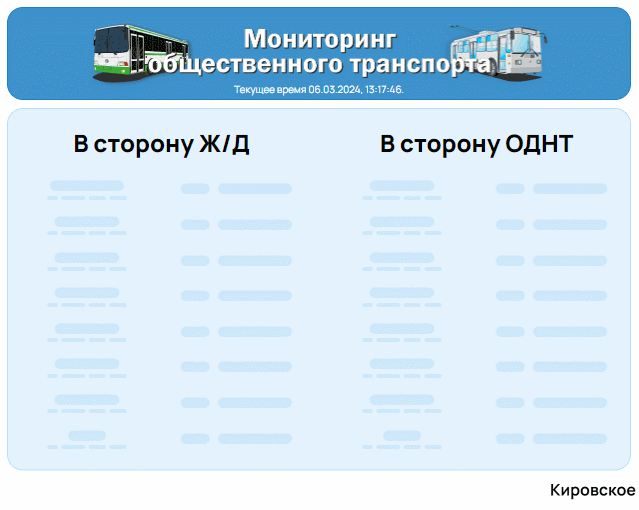

# cds-monitoring-board-kat

Информационное табло мониторинга прибытия общественного транспорта от ЦДС ГПТ (г. Киров) по двум направлениям (в сторону Ж/Д и в сторону ОДНТ) для Кировского авиационного техникума.



## Требования

- ОС Linux с графической подсистемой X11
- Установленные утилиты: `bash`, `python3`, `xrandr`, `chromium`

## Установка и запуск

1. Создайте файл конфигурации `.env` в корне проекта и укажите рабочий HTTPS-адрес источника данных (без query-параметров и фрагментов):
   ```env
   AVIA_URL="https://example.invalid/api"
   ```
2. Для запуска информационного табло в режиме киоска выполните скрипт:
   ```bash
   bash cds-start.sh
   ```
   Скрипт проверяет валидность `AVIA_URL`, генерирует клиентский файл `assets/app.js` из шаблона `assets/app.in.js`, настраивает вывод видеоподсистемы через `chresolution.sh` (`xrandr`) и запускает браузер Chromium в полноэкранном режиме киоска.

## Лицензия

[MIT](LICENSE)
